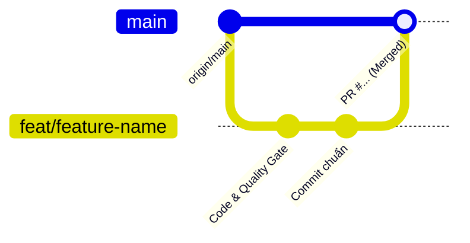

# HƯỚNG DẪN DÀNH CHO AGENT & DEVELOPER (SWP_RHT)

> **Tài liệu chuẩn hóa quy trình phát triển, đồng bộ Frontend – Backend, kiểm soát an toàn bảo mật và luồng Git cho hệ thống RaceHorse Transport System.**

---

## 1. Ngữ Cảnh Quan Trọng Của Dự Án (Project Context)

### 1.1. Kiến Trúc Repository & Công Nghệ
- **Mô hình Monorepo**: Repository GitHub `hankfwr23r2/SWP_RHT` (nhánh chính: `main`).
  - `backend/`: Java 21, Spring Boot 4, Spring Security (JWT Access Token + HttpOnly Refresh Token Cookie, RBAC `@PreAuthorize`), Hibernate/JPA, PostgreSQL (khi code dùng Postgres local chạy bằng Docker; bản deploy dùng Aiven). Context path toàn hệ thống: `server.servlet.context-path=/api/v1`.
  - `frontend/`: React 19, TypeScript, Vite, React Router, Vitest. Build ra 2 ứng dụng độc lập: Customer Portal (`/`) và Backoffice Portal (`/backoffice`). Deploy production trên Vercel.

### 1.2. 6 Luồng Nghiệp Vụ Cốt Lõi (Core Business Flows)
1. **Flow 1: Khách đặt đơn & Quản lý hồ sơ ngựa**: Khách tạo đơn (nội địa/quốc tế), chọn hoặc tạo hồ sơ ngựa, đính kèm giấy chứng nhận kiểm dịch.
2. **Flow 2: Thẩm định song song & Chốt xe - lộ trình**: Quản lý kích hoạt thẩm định song song. Kiểm dịch viên duyệt y tế; Điều phối viên chốt xe, lộ trình và phân công kíp xe độc lập.
3. **Flow 3: Phê duyệt báo giá & Đặt cọc 30%**: Quản lý duyệt và phát hành báo giá hiệu lực 24 giờ. Khách thanh toán cọc 30% để hệ thống phát hành số Vận đơn điện tử (Waybill). Khách hủy đơn tại bước này sẽ bị áp dụng quy tắc khấu trừ cọc.
4. **Flow 4: Vận hành chuyến & Đơn Trụ Sở (Single HQ)**: Tài xế và Hộ tống check-in từng mốc, quét chip, thu chứng từ gốc, nhận đủ 70% số dư trước khi xuất phát, bàn giao ngựa, báo quá hạn 2h nếu người nhận không đến. Xe và kíp xe sau khi giao ngựa **phải xác nhận trở về Trụ sở chính tại Việt Nam** mới chuyển sang trạng thái `AVAILABLE`.
5. **Flow 5: Sự cố hành trình (SOS) & Đề xuất đối tác**: Tài xế/Hộ tống báo SOS, Điều phối viên lập phương án trên bản đồ (gọi cứu hộ, đưa ngựa vào trạm nghỉ, đổi lộ trình), Quản lý duyệt phương án & chi phí.
6. **Flow 6: Quyết toán chi phí & Đóng đơn**: Tài xế nộp bảng kê chi phí phát sinh kèm hóa đơn, Quản lý đối soát và phát hành bảng quyết toán (hạn 24h), Khách thanh toán quyết toán và chấm điểm chuyến đi để hoàn tất đóng đơn.

### 1.3. Các Quy Tắc Nghiệp Vụ Bất Biến (Golden Rules)
- **Mô hình Đơn Trụ Sở (Single HQ)**: Mọi phương tiện và nhân sự xuất phát từ Trụ sở chính (Việt Nam) và bắt buộc phải quay về Trụ sở chính mới được giải phóng nhận chuyến mới.
- **Thanh toán 2 mốc 30% - 70%**: Cọc 30% để cấp Vận đơn; thanh toán 70% còn lại trước giờ xuất phát. Nếu khách chưa trả đủ 70%, hệ thống chặn không cho tài xế bắt đầu hành trình.
- **Thời gian chờ bàn giao tối đa 2 giờ (Grace Period)**: Nếu quá 2 giờ người nhận không tới, tài xế kích hoạt quy trình an sinh khẩn cấp (thuê chuồng/lưu ca xe), chi phí phát sinh được tính vào quyết toán cho khách hàng chịu.
- **Thẩm định song song (Parallel Review)**: Không làm tuần tự. Specialist và Coordinator làm việc đồng thời; Manager chỉ được duyệt báo giá khi cả hai bên đã hoàn tất.

---

## 2. Quy Trình Đồng Bộ Frontend & Backend Khi Sửa Lỗi / Phát Triển

### 2.0. Nguyên Tắc Bắt Buộc: Xác Nhận Trước Khi Sửa Code (Confirmation Before Edit)
> [!IMPORTANT]
> **Agent tuyệt đối không được tự ý sửa code khi chưa được người dùng xác nhận!**
> 1. **Bước 1 - Đưa ra phương án**: Giải thích rõ nguyên nhân, đề xuất giải pháp kỹ thuật cụ thể và danh sách file dự kiến sửa đổi.
> 2. **Bước 2 - Chờ xác nhận**: Hỏi ý kiến người dùng và dừng lại chờ phản hồi đồng ý.
> 3. **Bước 3 - Tiến hành thực hiện**: Chỉ bắt đầu sửa mã nguồn sau khi người dùng xác nhận đồng ý (ví dụ: "đồng ý", "làm đi", "ok", "tiến hành"...).

### 2.1. Chuẩn Hóa Routing & Tiền Tố Path
- Backend đã cấu hình `server.servlet.context-path=/api/v1` trong `application.properties`.
- **Quy tắc vàng Controller**: Tuyệt đối **không** đặt `@RequestMapping("/api/...")` ở đầu Controller, mà chỉ đặt đường dẫn tương đối (ví dụ: `@RequestMapping("/horses")`, `@RequestMapping("/delivery")`, `@RequestMapping("/incidents")`).
  - *Sai*: `@RequestMapping("/api/horses")` -> dẫn đến URL thực tế bị lặp: `/api/v1/api/horses` (lỗi 404).
  - *Đúng*: `@RequestMapping("/horses")` -> URL thực tế: `/api/v1/horses`.

### 2.2. Khớp Contract DTO Giữa Hai Đầu
- Mọi API client Frontend nằm tập trung trong `frontend/src/shared/api/`.
- Khi thay đổi trường dữ liệu ở DTO Backend (Java), phải cập nhật ngay interface tương ứng trong TypeScript.
- Dữ liệu trả về từ Spring Boot luôn bọc trong cấu trúc chuẩn:
  ```json
  {
    "status": "success",
    "message": "Thông báo",
    "data": { ... }
  }
  ```

### 2.3. Cơ Chế Dual-Mode (Resilience & 0 Breaking Tests)
Để vừa gọi API thực tế trên trình duyệt vừa giữ cho **toàn bộ Unit Test Vitest** luôn pass:
1. **Trên Trình duyệt người dùng thật (`typeof window !== 'undefined'`)**: Gọi trực tiếp REST API Spring Boot qua `apiClient`. Store khởi tạo mảng rỗng `[]`, không lưu mock data vào `sessionStorage`.
2. **Trong môi trường Kiểm thử Vitest (`import.meta.env?.MODE === 'test'`)**: Sử dụng test fixtures để các bài test logic nghiệp vụ chạy nhanh, độc lập và ổn định, không bị gãy khi CI/CD không có kết nối mạng.

### 2.4. Tiêu Chuẩn Kiểm Tra Chất Lượng (Quality Gate) Bắt Buộc
Trước khi đẩy bất kỳ commit nào lên Git, Agent bắt buộc phải chạy và đạt kết quả xanh cho tất cả các lệnh sau (lệnh backend chạy trong `backend/`, các lệnh còn lại trong `frontend/`). GitHub Actions (`.github/workflows/ci.yml`) chạy lại đúng các bước này cho mọi Pull Request:
```powershell
# 1. Kiểm tra Backend (Java 21): biên dịch và chạy test, cần Postgres local đang chạy (docker compose up -d postgres)
.\mvnw.cmd verify

# 2. Kiểm tra Lint Frontend (oxlint)
npm run lint

# 3. Kiểm tra kiểu dữ liệu TypeScript
npx tsc -b

# 4. Chạy toàn bộ Unit Test
npm test

# 5. Build kiểm tra bundle production
npm run build
```

---

## 3. Quy Trình Kiểm Tra Bảo Mật (Security Checklist)

### 3.1. Xác Thực & Quản Lý Token (JWT & Refresh Token)
- **Access Token**:
  - Lưu trữ tạm thời ở Client, tự động đính kèm qua Axios Interceptor: `Authorization: Bearer <token>`.
  - Khi API trả về mã lỗi `401 Unauthorized`, interceptor tự động xóa token và chuyển hướng về trang đăng nhập.
- **Refresh Token**:
  - Phải được truyền qua **`HttpOnly Cookie`** từ Backend để chống tấn công XSS.
  - Phía Client Axios bắt buộc phải bật cấu hình `withCredentials: true`.
- **Cảnh báo an toàn thông tin**:
  - Tuyệt đối **không bao giờ** commit mã bí mật, Personal Access Token (PAT) của GitHub (`gho_...`), mật khẩu tài khoản hoặc khóa bí mật JWT vào Git repository.

### 3.2. Kiểm Soát Phân Quyền (RBAC)
- Toàn bộ Controller phía Backend phải có tiền điều kiện `@PreAuthorize`:
  - Customer API: `@PreAuthorize("hasRole('CUSTOMER')")`
  - Specialist API: `@PreAuthorize("hasRole('SPECIALIST')")`
  - Coordinator API: `@PreAuthorize("hasRole('COORDINATOR')")`
  - Manager API: `@PreAuthorize("hasAnyRole('MANAGER', 'ADMIN')")`
  - Driver / Escort API: `@PreAuthorize("hasAnyRole('DRIVER', 'ESCORT')")`
- Phía Frontend, các trang thuộc Backoffice được bảo vệ bởi Route Guard (`AuthContext`), kiểm tra vai trò người dùng trước khi hiển thị màn hình nghiệp vụ.

### 3.3. Dữ Liệu Đầu Vào & Chống Lỗ Hổng
- Mọi DTO tiếp nhận dữ liệu từ Client bắt buộc sử dụng Bean Validation (`@NotNull`, `@NotBlank`, `@Size`, `@Pattern`).
- Khi phát sinh lỗi ngoại lệ, Backend không trả raw stack trace về client mà bọc qua `GlobalExceptionHandler` trả về thông báo an toàn.

---

## 4. Quy Trình Chuẩn Đẩy Code Lên `main` (Git Workflow)

Tuyệt đối không push code trực tiếp lên `main` mà chưa qua kiểm thử và quy trình nhánh an toàn:



### Các Bước Thực Hiện Chuẩn Xác:

#### Bước 1: Đồng bộ mã nguồn mới nhất từ `main`
```powershell
# Lưu tạm các thay đổi đang làm (nếu có)
git stash save "wip: temporary changes"

# Chuyển về main và kéo bản mới nhất
git checkout main
git pull origin main
```

#### Bước 2: Tạo nhánh tính năng mới
Đặt tên nhánh theo quy ước rõ ràng:
- Tính năng mới: `feat/<tên-tính-năng>`
- Sửa lỗi: `fix/<tên-lỗi>`
- Cấu hình/Tài liệu: `chore/<mô-tả>` hoặc `docs/<mô-tả>`

```powershell
git checkout -b feat/integrate-new-service
# Khôi phục lại các thay đổi đã lưu (nếu có)
git stash pop
```

#### Bước 3: Chạy Quality Gate kiểm thử toàn diện
Chạy đầy đủ 5 bước kiểm thử nêu tại mục 2.4. Nếu có bất kỳ lỗi nào xuất hiện, phải fix triệt để trước khi chuyển sang bước tiếp theo.

#### Bước 4: Commit theo chuẩn Conventional Commits
```powershell
git add .
git commit -m "feat: mô tả ngắn gọn thay đổi đã làm"
```

#### Bước 5: Đẩy nhánh lên Remote Repository
```powershell
git push -u origin feat/integrate-new-service
```

#### Bước 6: Tạo Pull Request & Merge an toàn
- Tạo Pull Request từ nhánh tính năng vào `main` (qua GitHub Web UI hoặc GitHub REST API script).
- Kiểm tra lại các file changes trên PR để đảm bảo không sót file thừa hoặc file cấu hình bí mật.
- Thực hiện Merge Pull Request vào `main`.

#### Bước 7: Đồng bộ local `main` sau khi merge
```powershell
git checkout main
git pull origin main
```
Xác nhận working tree hoàn toàn sạch (`git status` báo `working tree clean`).
