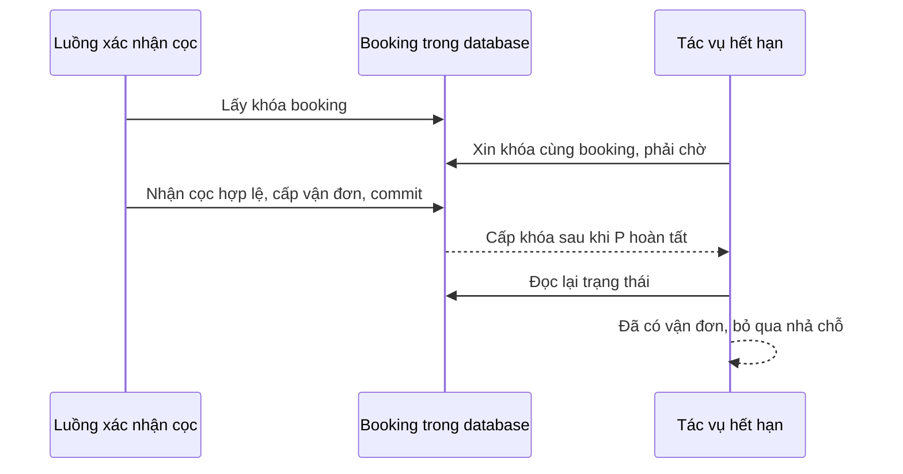

# Giải thích xử lý thanh toán cọc sát hạn báo giá

Tài liệu giải thích thay đổi trong [PR #280](https://github.com/hankfwr23r2/SWP_RHT/pull/280),
commit triển khai `b57a0a5`, đã merge vào `main` bằng commit `31f0aba`.
Các ví dụ dưới đây dùng giờ Việt Nam, với hạn cọc giả định là **10:00:00**.

## 1. Vì sao cần sửa?

Khách trả tiền thành công và backend nhận được thông báo thành công có thể xảy ra
ở hai thời điểm khác nhau. Mất mạng ở trình duyệt cũng không chứng minh thanh toán
ngân hàng đã thất bại.

Trước bản sửa, luồng thanh toán và tác vụ hết hạn có thể cùng đọc thấy đơn đang chờ
cọc, rồi một bên cấp vận đơn trong khi bên kia nhả xe và kíp xe. Backend cũng chưa
đối chiếu thời điểm khách thực trả với hạn báo giá khi nhận callback.

Ví dụ lỗi cũ:

| Thời điểm | Diễn biến |
|---|---|
| 09:59:59 | VNPAY ghi nhận khách thanh toán thành công. |
| 10:00:01 | Callback chưa tới. Tác vụ hết hạn thấy đơn chưa cọc, nhả phân công. |
| 10:00:03 | Callback thành công mới tới. Đơn đã hết hạn nên tiền bị đưa vào đối soát. |

Khách có thể trả đúng hạn nhưng vẫn mất chỗ. Bản sửa bổ sung khoảng chờ xác nhận
có giới hạn và đồng bộ hai luồng bằng khóa booking trong database.

| Nội dung | Trước bản sửa | Sau bản sửa |
|---|---|---|
| Nhận cọc và nhả chỗ | Chưa dùng chung khóa booking | Dùng chung khóa, kiểm tra lại trạng thái sau khi lấy khóa |
| Xét trả cọc đúng hạn | Chủ yếu theo trạng thái đơn | Kiểm tra thêm giờ VNPAY ghi nhận tiền và giờ nhận callback |
| Có phiên cọc đang chờ khi hết hạn | Có thể nhả chỗ ở lượt quét hết hạn | Chờ thêm tối đa 5 phút từ hạn báo giá |
| Chưa biết kết quả sau khoảng chờ | Chưa có quy tắc chờ xác nhận này | Nhả chỗ, giữ giao dịch chưa xác định để đối soát |
| Chu kỳ quét hết hạn | Mặc định 5 phút | Mặc định 30 giây |
| Giao diện | Chủ yếu báo thành công/thất bại | Thêm thông báo đang xác nhận và đã nhận tiền cần đối soát |

## 2. Phân biệt hạn thanh toán và khoảng chờ xác nhận

Hạn báo giá cũng là hạn thanh toán cọc. Link VNPAY hết hạn ở mốc sớm hơn giữa
thời gian sống của link (mặc định 15 phút) và hạn báo giá. Từ đúng giây hết hạn
báo giá/cọc, backend không tạo phiên cọc mới. Nếu chỉ link cũ hết hạn nhưng báo giá
vẫn còn hiệu lực, khách có thể tạo link thay thế.

| Mốc | Ý nghĩa | Ví dụ |
|---|---|---|
| Hạn link VNPAY | Hạn riêng của phiên thanh toán, gửi qua `vnp_ExpireDate` | Link tạo lúc 09:30 có thể hết hạn lúc 09:45 |
| Hạn báo giá/cọc | Hạn cuối khách được thanh toán cọc cho báo giá hiện tại | 10:00:00 |
| Hết khoảng chờ xác nhận | Mốc cuối nhận callback để áp dụng cọc nếu đơn vẫn giữ chỗ | 10:05:00 |

```text
Hạn link VNPAY = mốc sớm hơn giữa (giờ tạo link + 15 phút) và hạn báo giá
Hết khoảng chờ xác nhận = hạn báo giá + 5 phút
```

Đúng 10:00:00 đã hết hạn được thanh toán. Đúng 10:05:00 cũng đã hết khoảng chờ,
kể cả tác vụ nhả chỗ chưa kịp chạy. Năm phút này dành cho kết quả giao dịch đã trả
đúng hạn, không phải thêm năm phút để khách trả tiền.

## 3. Khi nào giữ thêm xe và kíp xe?

Nếu có giao dịch cọc VNPAY `PENDING` được tạo trong thời gian hiệu lực của báo giá
hiện tại, backend giữ nguyên phân công xe, driver và escort thêm tối đa 5 phút.
Thời gian này tính từ hạn báo giá, không tính lại theo callback hoặc lần tải trang.
API phân công kíp xe `assignCrew` chỉ cho phép đơn ở `pending_commercial`, nên bị
chặn ở bước chờ cọc. Lịch đang giữ vẫn được tính khi kiểm tra xung đột phân công
cho đơn khác. Phạm vi các API đã được bảo vệ được ghi cụ thể ở mục 12.

Đơn vẫn có trạng thái `awaiting_payment` trong khoảng chờ; không tạo trạng thái
booking mới. Phiên dùng để giữ thêm chỗ phải có loại `DEPOSIT`, phương thức `VNPAY`,
có giờ tạo trước hạn và thuộc báo giá hiện tại. Giao dịch của báo giá cũ không được
dùng để kéo dài giữ chỗ cho báo giá mới.

Nếu không có giao dịch phù hợp đang chờ, hoặc VNPAY đã xác nhận thất bại và không
còn phiên cọc phù hợp nào khác, đơn được nhả chỗ ở lượt quét hết hạn tiếp theo.
Không phải mọi đơn đều được giữ thêm 5 phút. Chu kỳ quét mặc định là 30 giây.

## 4. Thành công, thất bại và mất kết nối

Ví dụ hạn báo giá 10:00:00, kết thúc khoảng chờ là 10:05:00:

| Kết quả | Xử lý |
|---|---|
| Trả lúc 09:59:59, callback đến trước 10:05:00, đơn vẫn giữ chỗ | Cọc `COMPLETED`, báo giá `ACCEPTED`, đơn `waybill_issued`; giữ phân công |
| VNPAY báo thất bại | Payment `FAILED`; nếu đã hết hạn, nhả chỗ ở lượt quét tiếp theo |
| Trả từ 10:00:00 trở đi | Payment `NEEDS_REVIEW`, không cấp vận đơn |
| Callback thành công đến từ 10:05:00 trở đi, kể cả tác vụ chưa kịp quét | Payment `NEEDS_REVIEW`, không cấp vận đơn |
| Hết khoảng chờ mà chưa có kết quả | Đơn `quote_expired`, xóa liên kết xe/kíp xe; payment vẫn `PENDING` và có ghi chú chờ đối soát |
| Tiền về sau khi đã nhả chỗ hoặc từ phiên bị thay thế | Payment `NEEDS_REVIEW`, không tự khôi phục phân công |

`PENDING` có nghĩa là chưa biết kết quả, không phải xác nhận thanh toán thất bại.
`NEEDS_REVIEW` có nghĩa đã có thông báo tiền về nhưng chưa áp dụng được vào đơn.
Quản lý cần kiểm tra và xử lý hoàn tiền; hệ thống chưa tự động gọi API hoàn tiền.

### 4.1. Trả lúc 09:59:59 và callback về lúc 10:02:00

1. Khách trả trước hạn, nhưng backend chưa biết ngay kết quả.
2. Sau 10:00, tác vụ thấy phiên cọc còn `PENDING` và chưa hết khoảng chờ nên giữ phân công.
3. Lúc 10:02, callback được xác thực; giờ VNPAY ghi nhận tiền là 09:59:59.
4. Nếu đơn vẫn chờ cọc và đủ điều kiện, hệ thống nhận cọc và cấp vận đơn.

### 4.2. VNPAY báo thanh toán không thành công

Payment đang chờ chuyển thành `FAILED`, không cấp vận đơn. Khách có thể tạo phiên
mới nếu báo giá còn hạn. Nếu đã hết hạn và không còn phiên cọc phù hợp đang chờ,
tác vụ nhả phân công ở lượt quét tiếp theo.

Callback thất bại đến sau 10:05 vẫn được xử lý theo nhánh thất bại đối với giao dịch
còn chờ; không phải mọi callback muộn đều thành `NEEDS_REVIEW`.

### 4.3. Khách mất mạng trong lúc thanh toán

Có hai đường đưa kết quả về backend:

- **IPN:** VNPAY gọi trực tiếp backend để báo kết quả.
- **Return URL:** khi trình duyệt quay lại website, frontend gửi tham số về backend để kiểm tra.

Hai đường dùng chung logic xác nhận. Nếu trình duyệt mất mạng nhưng IPN vẫn tới,
backend vẫn có thể ghi nhận cọc; khách không bắt buộc quay lại trang để tiền được ghi nhận.

Nếu cả hai đường chưa đem kết quả tới backend, giao dịch có thể vẫn `PENDING`.
Hệ thống chỉ chờ trong giới hạn đã nêu, không suy đoán rằng khách chưa bị trừ tiền.

### 4.4. Hết 5 phút vẫn chưa nhận được kết quả

Từ 10:05, tác vụ đủ điều kiện nhả chỗ. Đơn thành `quote_expired`, báo giá thành
`EXPIRED`, xóa liên kết xe và phân công kíp xe. Giao dịch chưa xác định vẫn là
`PENDING`, kèm ghi chú chờ đối soát.

Nếu tiền được xác nhận về sau đó, giao dịch thành `NEEDS_REVIEW`. Hệ thống không tự
cấp vận đơn hay lấy lại xe/kíp xe đã có thể được giao cho đơn khác. Manager kiểm tra
và xử lý hoàn tiền.

## 5. Khóa chung booking hoạt động thế nào?

Có thể hình dung mỗi booking có một chìa khóa xử lý. Luồng nào lấy được khóa thì
xử lý trước; luồng còn lại chờ transaction kết thúc rồi đọc trạng thái mới.
Đây là khóa dòng trong database, không khóa tài khoản hay đóng màn hình khách.

**Nếu nhận cọc hợp lệ trước:** callback khóa đơn, ghi nhận tiền, cấp vận đơn rồi
commit. Tác vụ hết hạn sau đó mới lấy được khóa; thấy đơn đã `waybill_issued` thì
bỏ qua việc nhả phân công.

**Nếu tác vụ đã đủ điều kiện nhả chỗ và xử lý trước:** tác vụ khóa đơn, nhả phân
công, đổi thành `quote_expired` rồi commit. Callback sau đó đọc lại trạng thái;
nếu có tiền về thì đưa vào đối soát, không tự cấp vận đơn.



Trong callback, thứ tự lấy khóa là **booking rồi payment**. Khóa payment giúp IPN
và Return URL báo về cùng giao dịch không ghi nhận cọc hai lần.
Tác vụ hết hạn chỉ lấy danh sách ID trước, rồi mới khóa và đọc từng booking, tránh
dùng entity đã nạp trạng thái cũ trước lúc chờ khóa.

## 6. Backend xét thời điểm thanh toán ra sao?

Backend xác thực chữ ký và số tiền trước khi dùng `vnp_PayDate`. Thời điểm này được
đọc theo GMT+7, định dạng `yyyyMMddHHmmss`, theo
[tài liệu thanh toán VNPAY](https://sandbox.vnpayment.vn/apis/docs/thanh-toan-pay/pay.html).
Thông báo thành công phải có cả `vnp_ResponseCode` và `vnp_TransactionStatus`
bằng `00`. Để áp dụng cọc, backend còn kiểm tra:

- Đơn vẫn là `awaiting_payment`, chưa có cọc `COMPLETED` khác.
- Báo giá mới nhất vẫn là `PENDING`, có hạn và phiên cọc thuộc báo giá đó.
- `vnp_PayDate` hợp lệ, không trước giờ tạo phiên ở độ chính xác giây.
- Giờ trả tiền nhỏ hơn hạn báo giá, không nằm sau giờ backend nhận callback.
- Giờ nhận callback nhỏ hơn mốc kết thúc khoảng chờ.

`receivedAt` được ghi ngay khi vào hàm xác nhận, trước lúc chờ khóa booking.
Sau khi lấy khóa, điều kiện trạng thái đơn vẫn phải đạt. Thông báo thành công của
cọc mà thiếu/sai thời điểm được đưa vào đối soát, không lấy giờ nhận callback
để chứng minh khách trả đúng hạn.

Hạn được so sánh ở độ chính xác giây giống `vnp_ExpireDate`; giây hết hạn không còn
được thanh toán. `PaymentDate` của phiên chờ là giờ tạo phiên. Khi nhận thông báo
tiền về có thời điểm hợp lệ, trường này được cập nhật theo giờ VNPAY ghi nhận tiền.
Nếu thiếu/sai thời điểm, hệ thống lưu giờ nhận callback và ghi nhận cần đối soát;
giá trị đó không được dùng để chứng minh khách trả đúng hạn.

## 7. Nhả chỗ có đổi trạng thái xe thành AVAILABLE không?

Không trực tiếp. Code nhả chỗ xóa các liên kết trong `BOOKING_VEHICLE` và
`BOOKING_ASSIGNMENT`, không tự đặt `Vehicle.status = AVAILABLE` hay đổi trạng thái
gốc của nhân sự.

`FleetServiceImpl` tính khả năng nhận chuyến từ phân công đang hiệu lực, lịch trùng
và trạng thái gốc. Xe vẫn có thể không nhận được chuyến mới nếu đang bận đơn khác
hoặc bảo dưỡng. Việc nhả chỗ chỉ gỡ phần giữ lịch của đơn hết hạn này.

Bản sửa không thay đổi quy tắc Single HQ: xe/kíp xe đang thực hiện chuyến phải
xác nhận về trụ sở theo quy trình vận hành.

## 8. Giao diện thay đổi gì?

- Còn hạn: khách có thể tạo link cọc.
- Quá hạn và có phiên chờ phù hợp: hiện “Đang xác nhận thanh toán” và mốc giữ chỗ.
- Quá hạn: chặn tạo phiên mới trên trang đơn hàng; backend cũng kiểm tra lại hạn.
- Trang kết quả có `NEEDS_REVIEW`: hiện “Đã nhận tiền, cần đối soát”, không mời trả tiền lại.
- Trang đơn đang chờ cọc được cập nhật định kỳ để lấy kết quả mới.

API booking có trường tùy chọn `depositConfirmationUntil` (timestamp mili giây),
đồng bộ với TypeScript và mapper. Đây là mốc chờ xác nhận, không sửa `quote.expiresAt`.
Khoảng chờ không tự đóng cửa sổ VNPAY; giữ tab mở cũng không kéo dài hạn thanh toán.

## 9. Các file thực hiện thay đổi

Các liên kết dưới đây dẫn tới file triển khai trong repository.

| File | Vai trò |
|---|---|
| [ClockConfiguration.java](../../backend/src/main/java/com/example/racehorse_transport/config/ClockConfiguration.java) | Cung cấp đồng hồ để code kiểm tra thời gian và test cố định thời gian |
| [VnpayProperties.java](../../backend/src/main/java/com/example/racehorse_transport/config/VnpayProperties.java) | Đọc số phút chờ xác nhận |
| [DepositPaymentWindow.java](../../backend/src/main/java/com/example/racehorse_transport/util/DepositPaymentWindow.java) | Tính hạn, nhận diện phiên của báo giá và xét giờ trả tiền |
| [BookingRepository.java](../../backend/src/main/java/com/example/racehorse_transport/repository/BookingRepository.java) | Lấy ID và khóa booking để đọc trạng thái hiện tại |
| [PaymentRepository.java](../../backend/src/main/java/com/example/racehorse_transport/repository/PaymentRepository.java) | Tìm booking ID từ mã giao dịch trước khi lấy khóa booking rồi payment |
| [VnpayServiceImpl.java](../../backend/src/main/java/com/example/racehorse_transport/service/impl/VnpayServiceImpl.java) | Tạo link đúng hạn, xác nhận kết quả, kiểm tra thời điểm, ghi đối soát |
| [BookingServiceImpl.java](../../backend/src/main/java/com/example/racehorse_transport/service/impl/BookingServiceImpl.java) | Chờ/nhả chỗ, nhận cọc, khóa khi phân công/từ chối báo giá, trả mốc xác nhận |
| [PaymentServiceImpl.java](../../backend/src/main/java/com/example/racehorse_transport/service/impl/PaymentServiceImpl.java) | Lấy khóa booking trong các luồng hủy đơn liên quan |
| [QuotationExpiryScheduler.java](../../backend/src/main/java/com/example/racehorse_transport/scheduler/QuotationExpiryScheduler.java) | Quét hết hạn mặc định mỗi 30 giây |
| [BookingResponse.java](../../backend/src/main/java/com/example/racehorse_transport/dto/booking/BookingResponse.java) | Bổ sung `depositConfirmationUntil` |
| [application.properties](../../backend/src/main/resources/application.properties) | Cấu hình thời gian chờ và chu kỳ quét |
| [OrderDetailPage.tsx](../src/apps/customer/features/orders/OrderDetailPage.tsx), [nextStep.ts](../src/apps/customer/features/orders/nextStep.ts) | Hiển thị chờ xác nhận, chặn thanh toán sau hạn, cập nhật đơn định kỳ |
| [VnpayReturnPage.tsx](../src/apps/customer/features/payment/VnpayReturnPage.tsx) | Phân biệt nhận tiền cần đối soát với thất bại, hiển thị thông báo backend |
| [bookings.ts](../src/shared/api/bookings.ts), [booking.ts](../src/shared/types/booking.ts), [bookingMapper.ts](../src/shared/services/bookingMapper.ts) | Đồng bộ trường dữ liệu frontend với backend |

## 10. Cấu hình và thời điểm nhả chỗ thực tế

| Biến môi trường | Mặc định | Ý nghĩa |
|---|---|---|
| `VNPAY_EXPIRE_MINUTES` | `15` | Thời gian sống tối đa của link |
| `VNPAY_DEPOSIT_CONFIRMATION_GRACE_MINUTES` | `5` | Số phút chờ kết quả sau hạn báo giá |
| `VNPAY_QUOTATION_EXPIRY_SCAN_MS` | `30000` | Khoảng nghỉ giữa các lượt quét, tính bằng mili giây |

Các biến được Spring Boot đọc từ môi trường chạy backend. Nếu chạy Docker Compose
và muốn thay mặc định, cần truyền biến vào service backend trong Compose.

Tác vụ dùng `fixedDelay`, nghỉ 30 giây sau khi lượt trước kết thúc; lần đầu chạy
sau 10 giây từ lúc scheduler khởi động. Vì vậy 10:05 là mốc đủ điều kiện nhả chỗ,
không phải cam kết xóa phân công đúng giây đó. Thời gian thực tế còn phụ thuộc
lượt quét tiếp theo, thời gian chạy tác vụ và việc chờ khóa database.

Callback thành công đến từ 10:05 vẫn không được áp dụng cọc, dù tác vụ chưa kịp nhả chỗ.

## 11. Kiểm thử đã bổ sung

| Trường hợp | Kết quả cần kiểm tra |
|---|---|
| Trả trước hạn một giây, callback trong khoảng chờ | Nhận cọc, lưu giờ trả tiền VNPAY |
| Trả đúng giây hết hạn hoặc sau hạn | Đối soát, không cấp vận đơn |
| Callback thành công đúng mốc hết khoảng chờ | Đối soát dù tác vụ chưa quét |
| Thiếu/sai `vnp_PayDate` | Đối soát |
| Thất bại trong khoảng chờ | `FAILED`, không cấp vận đơn |
| Tạo phiên mới đúng mốc hết hạn | Bị từ chối |
| Phiên cũ bị thay thế nhưng có tiền về | Ghi `NEEDS_REVIEW`, không bỏ qua tiền thực nhận |
| Phiên đang chờ thuộc báo giá cũ | Không giữ thêm chỗ cho báo giá mới |
| Hết khoảng chờ, chưa có kết quả | Nhả phân công, giữ `PENDING` để đối soát |
| Đơn đã nhận cọc khi tác vụ lấy được khóa | Bỏ qua nhả chỗ |
| Gọi `assignCrew` khi chờ cọc | Bị chặn bởi điều kiện trạng thái |
| Frontend qua mốc hết hạn/hết khoảng chờ | Hiển thị đúng thông báo, không yêu cầu trả tiền lại |

Unit test dùng đồng hồ cố định để kiểm tra mốc hết hạn và mốc hết 5 phút, callback
chậm, thất bại, thiếu/sai thời điểm và phiên cũ. `DepositPaymentConcurrencyTest`
chạy PostgreSQL trong Testcontainers, kiểm tra cả hai thứ tự nhận cọc/nhả chỗ bằng
hai transaction thật và xác nhận luồng còn lại phải chờ khóa database.
Xem [DepositPaymentConcurrencyTest.java](../../backend/src/test/java/com/example/racehorse_transport/DepositPaymentConcurrencyTest.java).

Kết quả xác minh cho commit triển khai `b57a0a5`:

- `mvnw verify`: 381 test, không lỗi; 2 live test được bỏ qua theo cấu hình bộ test.
- `npm test`: 273 test đạt.
- `npm run lint`, `npx tsc -b`, `npm run build`: thành công.
- Backend, frontend và E2E trên CI của PR #280 đều thành công trước khi merge.

## 12. Phạm vi bảo vệ và giới hạn còn lại

Khóa booking được áp dụng trong các luồng tạo phiên VNPAY, callback, gửi báo giá,
`assignCrew`, từ chối báo giá, hủy đơn phía khách/hủy do đón ngựa thất bại và quét hết hạn.
`confirmDepositPaid` thực hiện trong transaction đang giữ khóa của luồng gọi nó.

Một đường xử lý cũ vẫn cần bổ sung bảo vệ: `confirmCoordinatorPlan` trong
`BookingServiceImpl` chưa lấy cùng khóa booking và chưa giới hạn trạng thái được
chốt lại phương án. Một request chốt phương án cũ có thể thay liên kết xe và ghi
lại trạng thái đơn sau bước thẩm định. Vì vậy bản sửa hiện tại không bảo đảm
mọi endpoint chỉnh booking đều được đồng bộ; không nên dùng API chốt phương án
để thay xe trong lúc chờ xác nhận cọc. Đây là giới hạn có sẵn, chưa được sửa trong PR #280.

Các giới hạn khác:

- Năm phút chờ giúp nhận kết quả chậm, không bảo đảm mạng luôn phục hồi trong thời gian đó.
- Hệ thống chưa tự truy vấn VNPAY để xác minh giao dịch thiếu callback và chưa tự gọi API hoàn tiền.
- Hạn link riêng từng phiên chưa được lưu và đối chiếu lại trong `DepositPaymentWindow`.
  Một phiên cũ vẫn `PENDING` thuộc báo giá hiện tại có thể giữ chỗ tới hạn báo giá
  cộng khoảng chờ, dù link đã hết hạn sớm hơn. Backend có kiểm tra hạn báo giá và dữ liệu callback như mô tả ở trên.
- Tiền về sau khi đã nhả chỗ cần manager đối soát; không tự khôi phục phân công.
